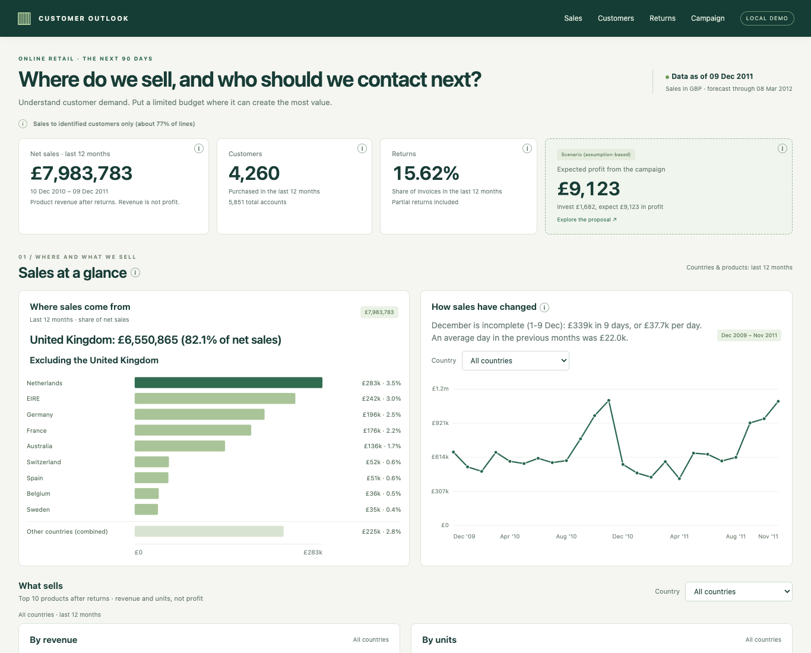

# Customer lifetime value and campaign optimization

Which customers of an online retailer are likely to buy again, how much are they
worth, and who should get an email or a coupon under a fixed marketing budget?
This project answers those questions end to end on two years of real UK
e-commerce transactions. An audited ETL cleans about one million invoice lines. A
model service compares BG/NBD + Gamma-Gamma against machine-learning baselines on
leakage-safe temporal backtests, then scores every customer. An integer
optimizer picks the most valuable campaign under budget and coupon limits, and a
read-only API and dashboard present the results to non-technical users.
Everything runs locally with Docker Compose.



## Key results

Every figure comes from the verification records. The page linked in the
Source column cites the original report and its raw evidence.

| Result | Value | Source |
| --- | --- | --- |
| Propensity ROC AUC, BG/NBD (runs A / B / C) | 0.8008 / 0.8112 / 0.8127 | [verification](docs/verification.md#propensity-models-temporal-backtests) |
| Propensity ROC AUC, gradient boosting (A / B / C) | 0.7990 / 0.8033 / 0.8061 | [verification](docs/verification.md#propensity-models-temporal-backtests) |
| Log loss, BG/NBD (A / B / C); lowest of all models in every run | 0.5524 / 0.5269 / 0.4979 | [verification](docs/verification.md#propensity-models-temporal-backtests) |
| BG/NBD aggregate purchase-count error (A / B / C) | -23.95% / -2.69% / +14.21% | [verification](docs/verification.md#propensity-models-temporal-backtests) |
| Campaign expected net value, exact solve (budget GBP 1,682, at most 300 coupons) | GBP 9,122.74 (ROI 5.4260) | [verification](docs/verification.md#campaign-optimizer) |
| Interactive solve: value and certified optimality gap | GBP 9,122.55, 0.003289% | [verification](docs/verification.md#campaign-optimizer) |
| Gain over a ratio-greedy heuristic | GBP 0.55 | [verification](docs/verification.md#campaign-optimizer) |
| API latency | reads < 300 ms; uncached interactive solves < 1 s | [verification](docs/verification.md#performance-and-startup) |

Campaign values are scenario outputs under assumed response rates and costs, not
measured campaign effects (see [Limitations](#limitations-and-caveats)).

## Architecture

```mermaid
flowchart LR
    xlsx[("online_retail_II.xlsx<br/>data/raw (read-only)")]
    subgraph compose["Docker Compose"]
        pg[("postgres<br/>PostgreSQL 17")]
        etl["etl<br/>batch job"]
        model["model<br/>batch job"]
        api["api<br/>FastAPI + optimizer"]
        dash["dashboard<br/>static HTML/JS"]
    end
    user(["Browser"])

    xlsx --> etl
    etl -- "raw, clean, RFM,<br/>quality report" --> pg
    pg -- "public tables" --> model
    model -- "modeling.* runs,<br/>metrics, predictions" --> pg
    pg -- "read-only snapshot" --> api
    dash -- "HTTP JSON" --> api
    user --> dash
```



Start-up order is enforced with health checks: `postgres` healthy → `etl` exits 0
→ `model` exits 0 → `api` healthy → `dashboard`. Only the API and dashboard
publish ports, both bound to localhost.

## Quick start

Requires Docker with Compose. Download `online_retail_II.xlsx` from the
[UCI repository](https://doi.org/10.24432/C5CG6D) into `data/raw/` first.

```sh
cp .env.example .env          # then set POSTGRES_PASSWORD
make up                       # docker compose up --build -d
docker compose ps --all       # etl/model: Exited (0); others: healthy
make down                     # stop; the database volume is kept
```

Then open the dashboard at <http://localhost:8080>; the API docs are at
<http://localhost:8000/docs>. Unit tests: `make venv && make test`. More options are in
[docs/running.md](docs/running.md).

## How it works

- **ETL** ([docs/etl.md](docs/etl.md)): seven ordered cleaning rules, including
  overlap removal between sheets, invalid stock codes, and one-to-one matching of
  quick purchase reversals. Each rule has standalone and sequential counts in a
  data quality report. RFM is rebuilt per cutoff, using only cancellations
  observed by that cutoff.
- **Model** ([docs/model.md](docs/model.md)): BG/NBD and Gamma-Gamma by maximum
  likelihood with NumPy/SciPy, compared with logistic regression, gradient
  boosting and two baselines. It runs three temporal experiments with calibration
  and paired bootstrap intervals, then production scoring at the last cutoff.
- **Optimizer** ([docs/optimizer.md](docs/optimizer.md)): chooses none, email or
  coupon per customer to maximize expected incremental profit under budget and
  coupon limits. It uses OR-Tools CP-SAT with an LP-derived certified bound and
  is compared against naive, email-only and ratio-greedy baselines.
- **API and dashboard** ([docs/api-and-dashboard.md](docs/api-and-dashboard.md)):
  read-only executive metrics, paged customer views, an interactive campaign with
  CSV export, and a collapsed "Method and evidence" section.

The full documentation index is at [docs/README.md](docs/README.md).

## Tech stack

- Python 3.12, pandas, SQLAlchemy, psycopg, openpyxl
- NumPy, SciPy (BG/NBD, Gamma-Gamma), scikit-learn
- OR-Tools (CP-SAT, GLOP)
- FastAPI, Uvicorn
- PostgreSQL 17
- Vanilla HTML/CSS/JavaScript with inline SVG charts
- Docker Compose, pytest, Playwright (browser checks), GitHub Actions

## Dataset

Chen, D. (2012). *Online Retail II*. UCI Machine Learning Repository.
<https://doi.org/10.24432/C5CG6D>. Licensed under
[CC BY 4.0](https://creativecommons.org/licenses/by/4.0/). The data covers
2009-12-01 to 2011-12-09 for a UK online gift-ware retailer with many wholesale
customers. The workbook is not included in this repository.

## Limitations and caveats

- **Campaign parameters are assumptions.** Offer response rates, margin, costs
  and discount are not estimated from data. An A/B test would be needed to
  measure them. Optimizer values are scenario outputs, not causal effects.
- **Seasonality.** Base rates shift between test windows. The production
  model's training label window includes the autumn/Christmas peak, while its
  scoring horizon is off-peak, so production probabilities are expected to be
  overestimated. Future outcomes are unavailable, so this is not verified.
- **BG/NBD bias varies across windows.** Aggregate purchase counts are too low in
  run A (-23.95%), too high in run C (+14.21%), and close in run B (-2.69%).
  Good ranking does not guarantee correct totals, and the experiments do not
  identify the cause.
- **Overlapping windows.** The backtests share data, so they are not independent
  replications.
- **Identified customers only.** Sales figures cover identified customers
  (about 77% of source lines). Anonymous lines are excluded.

## License

Code and documentation are released under the [MIT License](LICENSE). The
dataset is not included and remains under its own CC BY 4.0 license.
